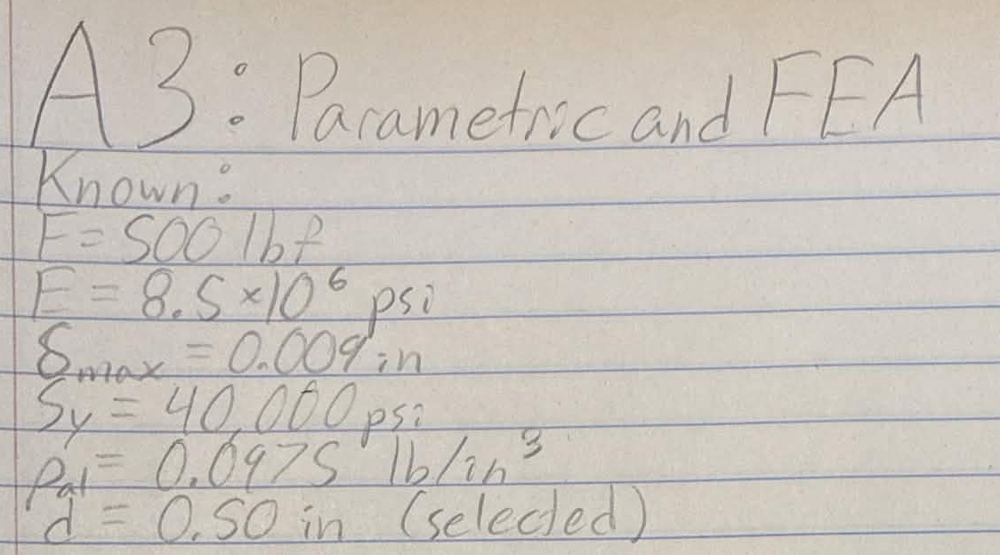
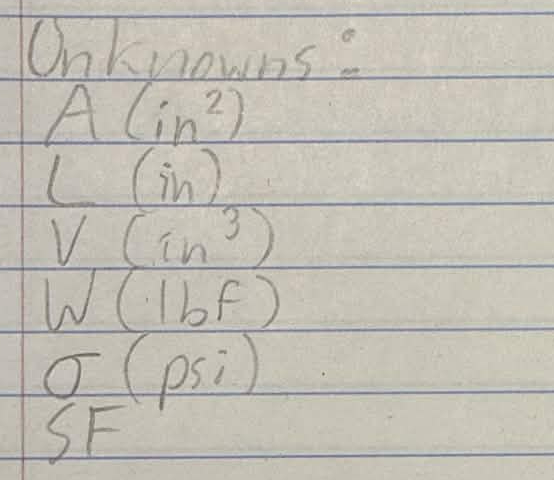
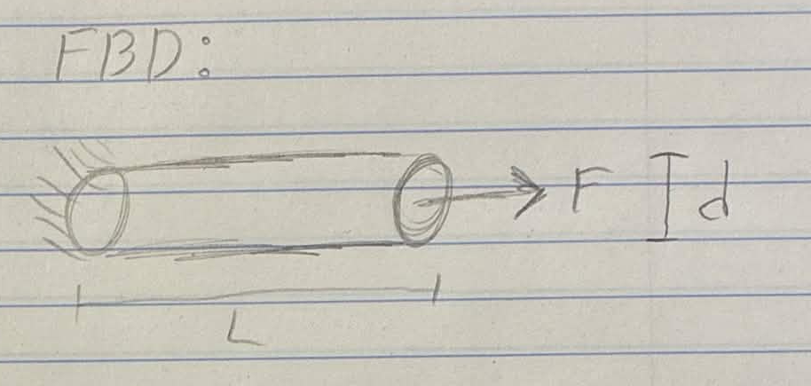
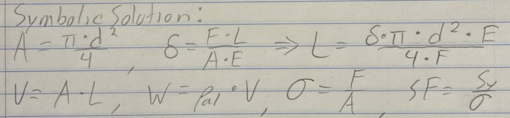
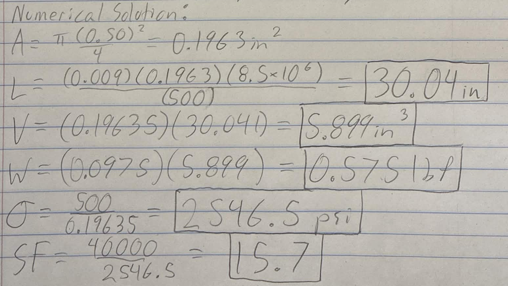

# A3 – parametric and FEA

## Objective

In this assignment I was tasked with designing an aluminum bar for stiffness under direct axial load, whilst limiting the deflection to 0.009 inches. To evaluate the maximum deflection I used the highest load of 500 lbf and the lowest Young's modulus of 8.5 × 10⁶ psi. I calculated the minimum geometry, built a parametric CAD model, and verified the results using Finite Element Analysis (FEA).

## Analyze

Firstly, I listed the known values provided from the assignment, the density for standard 6061 aluminum(acquired from the default data in solid works), and the diameter of the bar(manually selected).

Secondly, I listed the unknown values that I needed to solve for. These included the cross sectional area, length, volume, weight, axial stress, and safety factor. As is standard I also drew an accompanying free body diagram.

Thirdly I consulted course materials and the internet for the necessary equations for each unknown value.

Lastly, I manually calculated each unknown value by plugging in respective values from the known values listed and from prior calculations as I went through them.

## Decide

## Communicate

